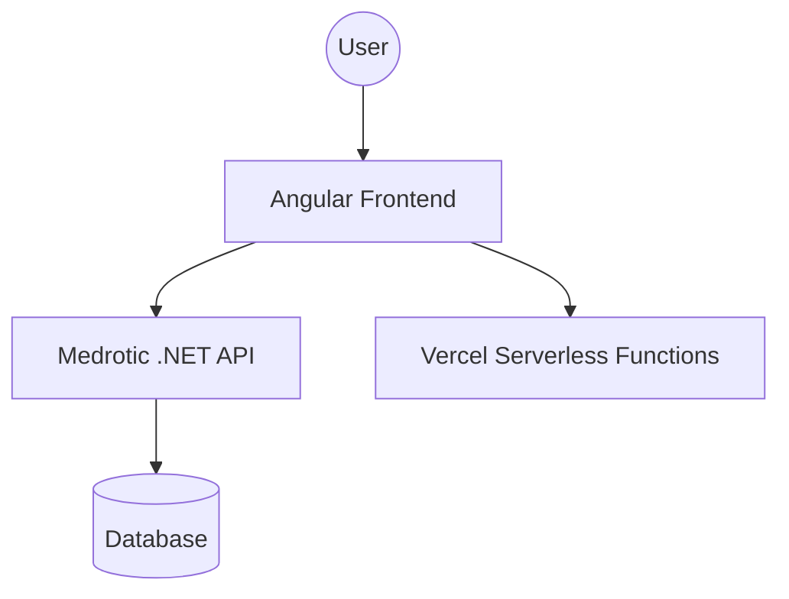

# <p align="center"></p>

# 🏥 Medrotic - Advanced Healthcare Platform

Medrotic is a state-of-the-art healthcare management system designed to provide a seamless experience for patients, doctors, and administrators. Built with a focus on modern aesthetics, security, and performance, it bridges the gap between healthcare providers and patients.

---

## 🏗️ Architecture Overview

Medrotic follows a decoupled architecture with an **Angular** frontend and a **.NET Core** backend.



---

## ✨ Key Features

### 👤 Patient Portal

- **Intuitive Dashboard**: Overview of health metrics and upcoming appointments.
- **CNIC-First Identity**: Secure identity management using region-specific identifiers.
- **AI Health Assistant**: Integrated chatbot for preliminary health queries and guidance.
- **Health Records**: Secure access to medical history, X-rays, and digital prescriptions.

### 🩺 Doctor Portal

- **Advanced Patient Management**: Specialized tools for patient history and record-linked lookups.
- **AI-Powered Diagnostics**: Support for approving and managing AI-generated diagnostic results.
- **Schedule Optimization**: Real-time tracking of appointments and surgical consultations.
- **Document & Imaging**: Direct management of X-rays and medical documentation.

### 🛡️ Admin Dashboard

- **System-Wide Control**: Management of doctors, patients, hospitals, and sub-admins.
- **Performance Analytics**: Real-time system health monitoring and user KPIs.
- **Audit & Compliance**: Secure role-based access control and detailed activity logs.

---

## 🛠️ Technology Stack

| Layer | Technology |
| :--- | :--- |
| **Frontend Framework** | [Angular 20.3](https://angular.dev) |
| **Backend Framework** | [.NET Core API](https://dotnet.microsoft.com/) |
| **Styling & UI** | Bootstrap 5, SCSS, Custom Premium Animations |
| **Data Visualization** | Chart.js |
| **Hosting** | Vercel (Edge Functions & SSR) |

---

## 🚀 Getting Started

### Prerequisites

- **Node.js**: v18+ (LTS recommended)
- **.NET SDK**: v8.0+ (for API development)
- **Angular CLI**: Optional, but recommended (`npm i -g @angular/cli`)

### Installation

1. **Clone the repository**:

   ```bash
   git clone https://github.com/YourRepo/Medrotic.git
   ```

2. **Frontend Setup**:

   ```bash
   cd Medrotic
   npm install
   ```

3. **Backend Setup**:

   ```bash
   cd Medrotic.Api
   dotnet restore
   ```

### Running Locally

Wait, how do we run it? The standard `npm start` (which runs `ng serve`) is good for the frontend.

For development, you can run the following:

- **Frontend**:

  ```bash
  npm start
  ```

- **Backend API**:

  ```bash
  cd Medrotic.Api/Medrotic.Api
  dotnet run
  ```

---

## 📁 Project Structure

```text
Medrotic/
├── src/                # Frontend Angular source
│   ├── app/            # Main application logic
│   │   ├── admin/      # Admin dashboard module
│   │   ├── doctor/     # Doctor portal module
│   │   ├── patient/    # Patient portal module
│   │   └── common/     # Shared components (Home, FAQ, etc.)
│   └── public/         # Static assets & images
├── Medrotic.Api/       # Backend .NET Solution
├── api/                # Vercel serverless functions
└── vercel.json         # Deployment configuration
```

---

## 🌐 Environment Configuration

Angular uses `src/environments` for configuration.

- **Development**: `src/environments/environment.ts`
- **Production**: `src/environments/environment.prod.ts`

Make sure to update the `apiUrl` to point to your deployed Medrotic.Api instance.

For contact form SMTP delivery (handled only on the server), set these environment variables in your hosting platform:

- `SMTP_HOST`
- `SMTP_PORT` (for example, `587`)
- `SMTP_SECURE` (`true` or `false`)
- `SMTP_USER`
- `SMTP_PASS`
- `CONTACT_FROM` (optional sender address; defaults to `SMTP_USER`)
- `CONTACT_FROM_NAME` (optional sender display name, for example `Medrotic Support`)
- `CONTACT_RECIPIENT` (private inbox address that receives contact form submissions)

Do not place SMTP credentials or contact recipient addresses in frontend files.

---

## 📦 Scripts

| Command | Description |
| :--- | :--- |
| `npm start` | Runs `ng serve` for local frontend development. |
| `npm run build` | Builds the production bundle in `dist/`. |
| `npm test` | Executes unit tests via Karma. |
| `npm run serve:ssr:frontend` | Serves the SSR version of the app locally. |

---

## 📜 License

Distributed under the MIT License. See `LICENSE` for more information.

---

<p align="center">Developed by the Medrotic Team at CUI.</p>
